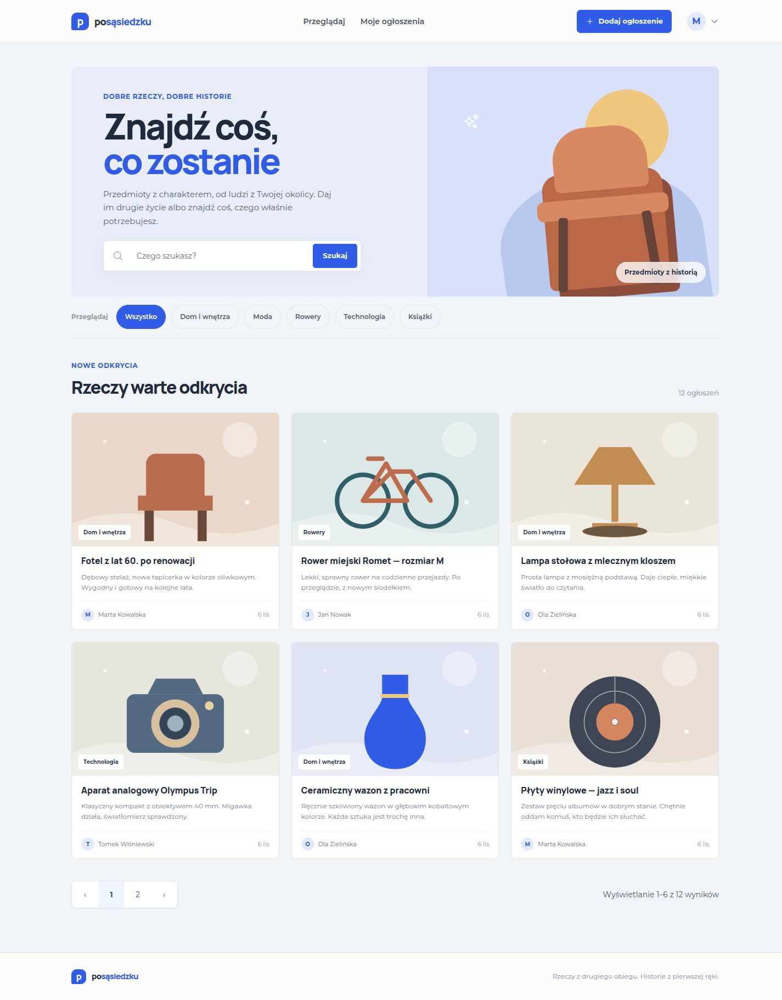
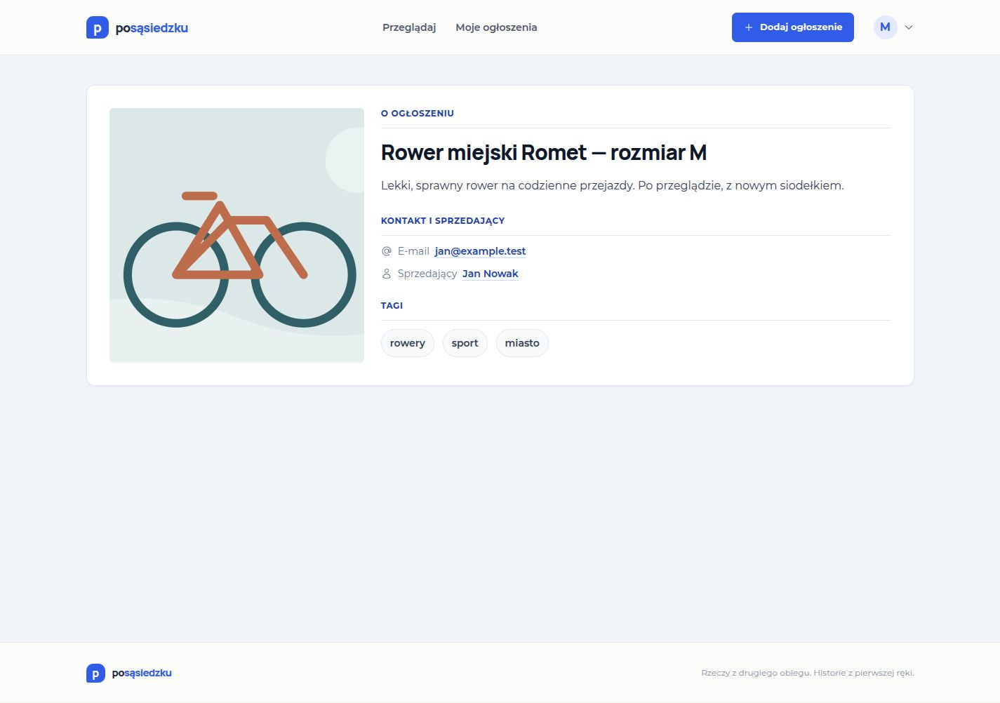

# posąsiedzku

Marketplace z rzeczami z drugiego obiegu. Użytkownicy mogą odkrywać ogłoszenia z okolicy, dodawać własne przedmioty, opisywać je tagami i kontaktować się ze sprzedającym.





## Funkcje

-   Katalog zatwierdzonych ofert z wyszukiwaniem po tytule i opisie oraz filtrowaniem po kategoriach i dokładnych tagach.
-   Tworzenie, edycja i usuwanie własnych ogłoszeń, także bez tagów.
-   Dodawanie zdjęcia z podglądem; pliki trafiają do Laravel Storage, a usunięcie ogłoszenia usuwa powiązany plik.
-   Konto użytkownika, weryfikacja adresu e-mail, edycja profilu i hasła oraz panel „Moje ogłoszenia”.
-   Panel administratora do zatwierdzania ofert i zarządzania rolami użytkowników.
-   Responsywny interfejs po polsku, z etykietami formularzy, stanami błędów i widocznym focusem klawiatury.

## Technologie

-   **Backend:** PHP 8.2+, Laravel 11, MySQL 8, Laravel Sail.
-   **Frontend:** Vue 3, Inertia.js, Tailwind CSS, Vite.
-   **Jakość:** PHPUnit, ESLint, Prettier i GitHub Actions.

Laravel obsługuje routing, walidację, autoryzację, bazę danych i pliki. Widoki są stronami Vue renderowanymi przez Inertia; projekt nie utrzymuje osobnego serwera API.

## Architektura i decyzje

-   `ListingService` koordynuje tworzenie, edycję i usuwanie oferty, a `ImageService` odpowiada za zapis i usuwanie plików.
-   `ListingPolicy` egzekwuje uprawnienia właściciela i administratora; middleware chroni panel administracyjny.
-   Testy wymuszają bazę MySQL `testing` i odświeżają jej schemat przez `RefreshDatabase`, niezależnie od lokalnej bazy aplikacji.

## Uruchomienie przez Sail

Wymagania: Docker z Compose, Composer 2 i PHP 8.2+ do pierwszego `composer install`.

1. Skopiuj plik środowiskowy i ustaw połączenie z MySQL Sail:

    ```sh
    cp .env.example .env
    ```

    W `.env` ustaw wartości:

    ```dotenv
    DB_CONNECTION=mysql
    DB_HOST=mysql
    DB_PORT=3306
    DB_DATABASE=laravel
    DB_USERNAME=sail
    DB_PASSWORD=password
    ```

2. Zainstaluj zależności PHP, uruchom kontenery i przygotuj lokalną bazę aplikacji:

    ```sh
    composer install
    ./vendor/bin/sail up -d
    ./vendor/bin/sail artisan key:generate
    ./vendor/bin/sail artisan migrate --seed
    ```

3. Zbuduj zależności frontendu i uruchom Vite:

    ```sh
    ./vendor/bin/sail npm ci
    ./vendor/bin/sail npm run dev
    ```

    Aplikacja będzie dostępna pod adresem [http://localhost](http://localhost). Zatrzymaj kontenery poleceniem `./vendor/bin/sail down`.

### Dane demonstracyjne

Seeder tworzy 12 przykładowych ofert i cztery konta sprzedających. Na świeżej bazie możesz zalogować się na `marta@example.test` z hasłem `password`. Pozostałe konta to `jan@example.test`, `ola@example.test` i `tomek@example.test`; hasło jest takie samo przy ich pierwszym utworzeniu. Ponowne seedowanie nie zmienia haseł istniejących kont.

Przykładowe ilustracje SVG są częścią repozytorium. Zdjęcia przesłane przez użytkowników są przechowywane osobno w publicznym dysku aplikacji.

## Testy i kontrole jakości

Testy korzystają z osobnej bazy MySQL `testing` skonfigurowanej w `phpunit.xml`; `RefreshDatabase` przygotowuje schemat testowy. Nie zmieniają bazy deweloperskiej.

```sh
./vendor/bin/sail artisan test
./vendor/bin/sail npm run format:check
./vendor/bin/sail npm run lint
./vendor/bin/sail npm audit --audit-level=moderate
./vendor/bin/sail npm run build
```

GitHub Actions uruchamia te kontrole na pushu i pull requeście. Audyt zależności zgłasza obecnie jedną podatność o niskim poziomie w `deepmerge`; upstream nie opublikował jeszcze poprawionej wersji.

## Przykładowy opis do CV

> Zbudowałem responsywny marketplace w Laravel 11 i Vue 3/Inertia. Zaimplementowałem katalog z wyszukiwaniem i filtrowaniem, pełny cykl życia ogłoszeń z uploadem zdjęć oraz moderację administratora. Dodałem testy feature i CI z lintowaniem, audytem zależności oraz buildem frontendu. Testy: 17 przypadków, 61 asercji.

## Zakres demonstracyjny

Projekt jest demonstracją portfolio. Nie zawiera płatności ani wewnętrznego czatu; kontakt między użytkownikami odbywa się przez dane podane w ogłoszeniu. Konta demo i przykładowe dane są przeznaczone do lokalnego środowiska Sail.
